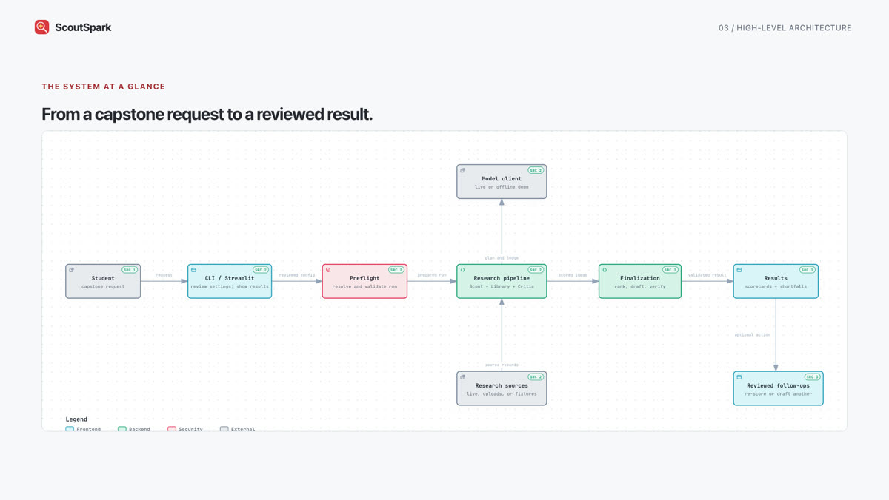
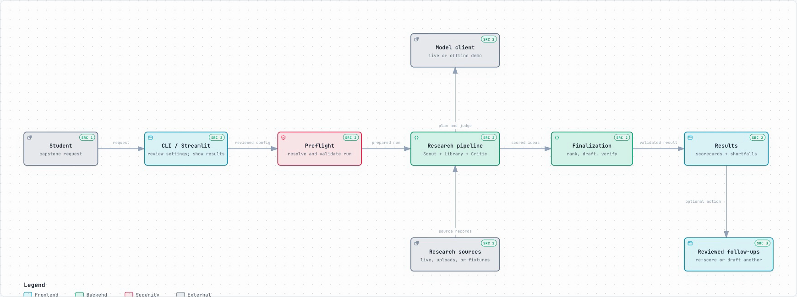
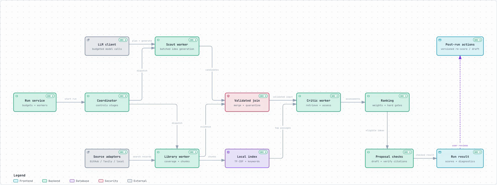
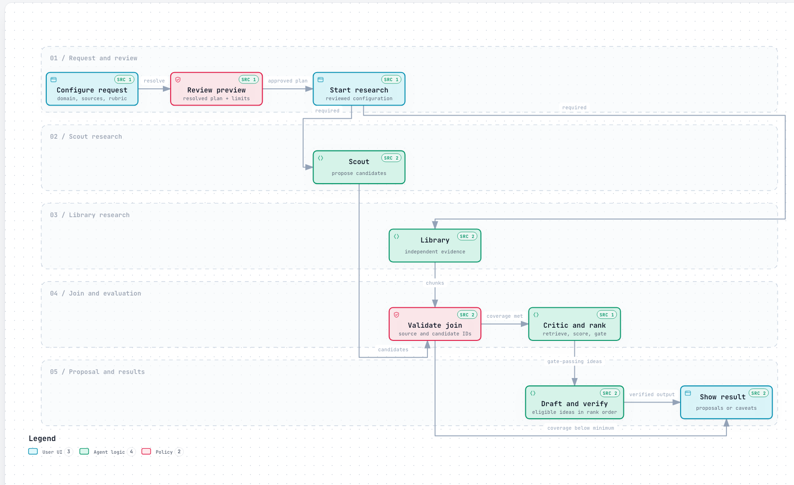

<p align="center">
  
</p>

<h1 align="center">Find a capstone idea you can actually build.</h1>

<p align="center">
  ScoutSpark helps students explore project ideas that fit their interests,
  skills, time, and resources. It searches for supporting sources and shows
  when the evidence is not strong enough for a detailed plan.
</p>

<p align="center">
  <a href="https://www.python.org/downloads/"></a>
  
  <a href="https://github.com/FaniBhushan/SparkScout/issues/new/choose"></a>
</p>

<p align="center">
  <a href="docs/media/scoutspark-preview.mp4">
    
  </a>
</p>

<p align="center"><a href="docs/media/scoutspark-preview.mp4"><strong>▶ Watch the one-minute walkthrough</strong></a></p>

> **Limited preview · 9 October 2026**
>
> Results can be incomplete or unverified. Check the sources and warnings before
> relying on an idea. The full reliability review is still in progress. Read the
> [preview notes](docs/v2-limited-preview-2026-10-08.md) for details.

## Why I built it

When I was researching capstone projects, finding an idea that fit my criteria
took a lot of manual work. I built a research agent to help with that search.
The results were useful, so I turned it into a general tool for exploring
capstone project ideas.

## Try it on your computer

You need Python 3.10 or newer. ScoutSpark runs locally, using your own model and
search API keys. The **Offline demo** works without keys and uses made-up
examples; it does not search the live web.

```sh
git clone https://github.com/FaniBhushan/SparkScout.git
cd SparkScout
python -m venv .venv
source .venv/bin/activate
python -m pip install -r requirements.txt
python -m streamlit run streamlit_app.py
```

On Windows PowerShell, activate the environment with
`.venv\Scripts\Activate.ps1` instead of `source .venv/bin/activate`.

When the app opens, choose **Offline demo** to explore without credentials. For
live research, choose **Live sources** and provide your own `OPENAI_API_KEY`
and `TAVILY_API_KEY`. A GitHub token is optional. You can put the keys in a
`.env` file in your local copy of the repository:

```text
OPENAI_API_KEY=your_openai_key
TAVILY_API_KEY=your_tavily_key
```

Keep `.env` private. Never commit it or post keys in feedback. Live model and
search services may charge you, so review the budget controls before starting a
run.

## How it works

1. You describe what you want to build, along with your limits.
2. **Scout** searches for problems and suggests project ideas.
3. **Library** independently looks for more evidence.
4. **Critic** compares each idea with the evidence and checks practical limits.
5. ScoutSpark shows scores, sources, and reasons an idea may not be ready.

It writes a detailed proposal only when its checks pass. You can also request an
exploratory proposal, which is clearly marked as unverified.

### ScoutSpark diagrams

Click each preview to open its interactive Archify page. The HTML source links
open each of the three diagram files in the repository.

[](https://htmlpreview.github.io/?https://github.com/FaniBhushan/SparkScout/blob/main/docs/media/scoutspark-architecture-high-level.html)

**High-level architecture** · [Open interactive diagram](https://htmlpreview.github.io/?https://github.com/FaniBhushan/SparkScout/blob/main/docs/media/scoutspark-architecture-high-level.html) · [HTML source](docs/media/scoutspark-architecture-high-level.html)

[](https://htmlpreview.github.io/?https://github.com/FaniBhushan/SparkScout/blob/main/docs/media/scoutspark-architecture-low-level.html)

**Detailed run architecture** · [Open interactive diagram](https://htmlpreview.github.io/?https://github.com/FaniBhushan/SparkScout/blob/main/docs/media/scoutspark-architecture-low-level.html) · [HTML source](docs/media/scoutspark-architecture-low-level.html)

[](https://htmlpreview.github.io/?https://github.com/FaniBhushan/SparkScout/blob/main/docs/media/scoutspark-research-run-flowchart.html)

**Research run flowchart** · [Open interactive diagram](https://htmlpreview.github.io/?https://github.com/FaniBhushan/SparkScout/blob/main/docs/media/scoutspark-research-run-flowchart.html) · [HTML source](docs/media/scoutspark-research-run-flowchart.html)

All three diagrams are made with Archify. You can also read the
[plain-language guide to results](docs/getting-useful-results.md).

## What to expect

ScoutSpark is an early preview. It may show fewer ideas than requested, find
sources that do not support a useful plan, or withhold a detailed proposal. In
the saved preview checks, the offline run missed its requested candidate count
in all ten repeats, and one live pilot returned no verified proposals. These
checks are small and do not establish general quality. See the
[release check and its limits](docs/v2-release-check-2026-10-08.md).

Please share bugs, confusing results, source problems, and ideas for improvement
through [GitHub Issues](https://github.com/FaniBhushan/SparkScout/issues/new/choose).
Do not include API keys, personal data, or private documents in public issues.

## More details

- [How to get useful results](docs/getting-useful-results.md)
- [How scoring and warnings work](docs/candidate_scoring.md)
- [Source and privacy limits](docs/guardrails.md)
- [Evaluation results](evals/README.md)
- [Pending and future tasks](TASKS.md)
